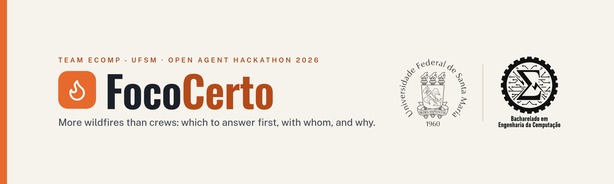
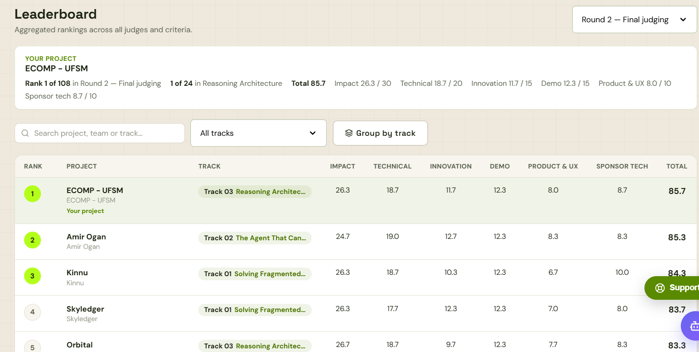
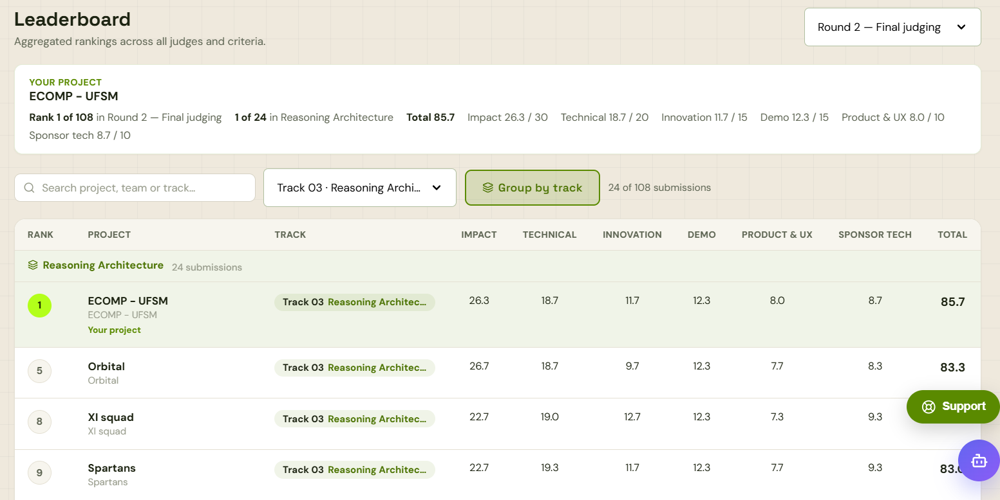
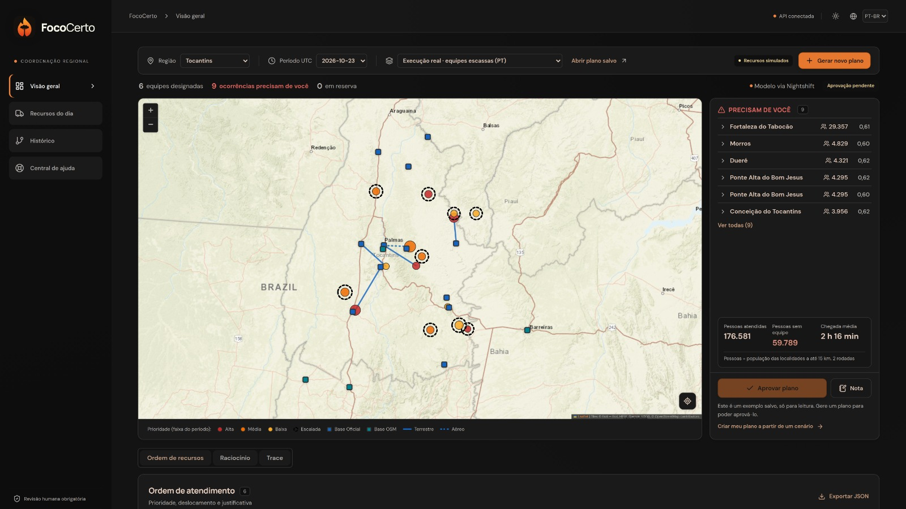
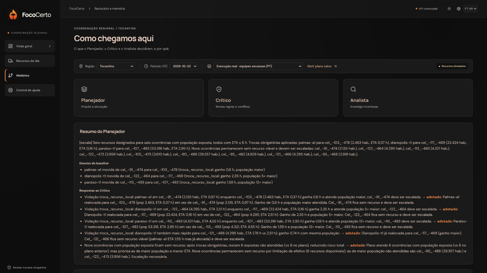
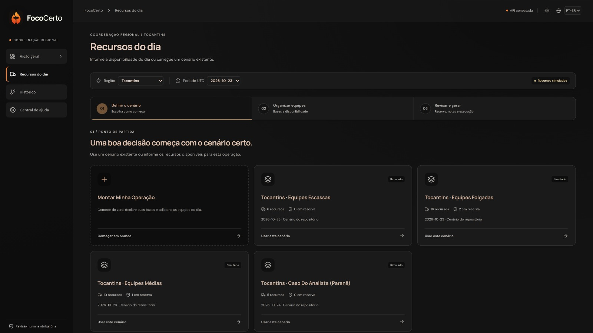

<div align="center">

  

  <br/>

  # ECOMP - UFSM · GenAI
  ### **Engenharia de Computação · Universidade Federal de Santa Maria (UFSM) 🇧🇷**

  *Iniciativa acadêmica de pesquisa e desenvolvimento em sistemas multi-agente, inteligência artificial generativa e arquiteturas de raciocínio aplicadas a desafios reais.*
  <br/>
  *Academic research & software engineering initiative focused on multi-agent systems, generative AI, and reasoning architectures applied to real-world challenges.*

  <br/>

  [](https://hackathon.genai.works/event/open-agent-hackathon-2026)
  [](https://hackathon.genai.works/event/open-agent-hackathon-2026)
  [](https://ufsm.br)
  [](https://ufsm.br)

</div>

---

<details>
  <summary><h3>🌐 English Version / Switch to English (Click to expand)</h3></summary>

<br/>

### 🌟 About the Organization

We are a team of developers and undergraduate researchers from the **Computer Engineering** program at the **Technology Center (CT)** of the **Federal University of Santa Maria (UFSM)**, Rio Grande do Sul, Brazil, advised by **Prof. Lucas Feksa Ramos**.

Our focus is engineering Artificial Intelligence solutions grounded in **rigorous software engineering**: combining distributed systems, reflective reasoning architectures, deterministic fact-checking, and zero-hallucination guard rails to address high-stakes socio-environmental challenges.

As our inaugural milestone, we achieved **1st Place Overall** (among 108 global finalists out of 547 participating teams) and **1st Place in the Reasoning Architecture Track (Track 3)** at the **Open Agent Hackathon 2026**, an international competition organized by *GenAI Works* in partnership with *NVIDIA* and industry leaders.

---

### 🏆 Global Recognition: Open Agent Hackathon 2026

Evaluated by industry experts across **Impact (30)**, **Technical Quality (20)**, **Innovation (15)**, **Demo (15)**, **Product & UX (10)**, and **Sponsor Tech Usage (10)**, achieving **85.7 / 100 points**.

| 🥇 1st Place Overall (1 of 108 Finalist Projects) | 🥇 1st Place Reasoning Architecture (1 of 24) |
|:---:|:---:|
| <a href="assets/leaderboard_geral.png"></a> | <a href="assets/leaderboard_reasoning.png"></a> |
| *Final round overall leaderboard* | *Multi-agent Reasoning Architecture track leaderboard* |

---

### 🚒 Featured Project: [FocoCerto](https://github.com/ufsm-ecomp-genai/fococerto)

> **When there are more wildfires than crews, FocoCerto helps a regional coordinator decide which fires to attend first, with which crew, and provides evidence-backed rationales.**

The system aggregates NASA FIRMS satellite detections into regional fire incidents, cross-referencing real-time weather (Open-Meteo), official brigade stations (CBMTO, Prevfogo/Ibama, ICMBio), and population exposure (GeoNames/OSM). Three specialized agents (**Planner**, **Critic**, and **Analyst**) negotiate optimal resource distribution under hard rule verification, zero hallucination tolerance, and mandatory human supervision.

#### 📍 1. Operations Overview (Tactical Map & Incident Triage)
*Real-time tactical operations map with priority-graded incidents, crew transit routes, and human escalation triage.*

<div align="center">
  
</div>

<br/>

#### 🧠 2. Reflective Reasoning & Audit Trail ("How We Got Here")
*Full transparency audit trail: the Planner proposes, the Critic negotiates trade-offs to protect more lives in less travel time, and the Analyst investigates multi-day time series data.*

<div align="center">
  
</div>

<br/>

#### 📋 3. Operational Setup ("Daily Resources")
*Guided workflow for emergency coordinators to configure daily crews, aircraft, minimum reserves, or load contingency benchmarks.*

<div align="center">
  
</div>

---

### 📊 Measured Results (Ablation on Real Satellite Data)

* 🎯 **82.8% decision accuracy** on critical benchmark checks (vs. 22.2% from traditional greedy allocation).
* ⏱️ **~36% reduction in average waiting time** for endangered communities (from 4.4 hours down to 2.8 hours).

---

### 🛠️ Focus Areas & Technology Stack

<div align="center">

```
               ┌───────────────────────────────┐
               │     Software Engineering      │
               │  Python · TypeScript · React  │
               └───────────────┬───────────────┘
                               │
       ┌───────────────────────┴───────────────────────┐
       ▼                                               ▼
┌───────────────────────────────┐     ┌───────────────────────────────┐
│     Multi-Agent Systems       │     │     Data & Infrastructure     │
│  LangGraph · Reasoning LLMs   │     │  PostgreSQL · Zetaris SQL     │
│  Fact-checking · Guard rails  │     │  H-MEM · Docker · REST APIs   │
└───────────────────────────────┘     └───────────────────────────────┘
```

<br/>
  
  
  
  
  
  
  
  
  
  
</div>

---

### 👥 Team Members

Undergraduate Computer Engineering students at UFSM under faculty advisory:

* **Enzo Augusto Mucha Domingues** — *Backend, AI Agents & Data Architecture*
* **Fernando Dorneles da Silva** — *Backend, AI Agents & Memory Systems*
* **Eduardo Jacques Pereira** — *Frontend & Interface Engineering (React)*
* **Gabriel Mazui Azevedo** — *Frontend & Product Design*
* **Lucas Lima Mendes dos Santos** — *Frontend & Geospatial Map Visualizations*
* **Prof. Lucas Feksa Ramos** — *Faculty Advisor & Mentorship (Technology Center / UFSM)*

---

### 🌐 Official Links & Contact

* 💻 **Project Repository:** [ufsm-ecomp-genai/fococerto](https://github.com/ufsm-ecomp-genai/fococerto)
* 🏫 **Institution:** [Federal University of Santa Maria (UFSM)](https://ufsm.br) · [Technology Center (CT)](https://www.ufsm.br/unidades-universitarias/ct)
* 🎓 **Degree:** [B.Sc. in Computer Engineering](https://www.ufsm.br/cursos/graduacao/santa-maria/engenharia-de-computacao)
* 📰 **Official News:** [UFSM team wins 1st place in global AI competition](https://ufsm.br/r-1-74622)
* 📺 **Demo Video:** [YouTube](https://www.youtube.com/watch?v=iD9EWLMdMzg)

<br/>

<div align="center">
  <sub>ECOMP - UFSM · Technology Center · Federal University of Santa Maria · Brazil 🇧🇷</sub>
</div>

</details>

---

<details open>
  <summary><h3>🇧🇷 Versão em Português (Padrão)</h3></summary>

<br/>

### 🌟 Sobre a Organização

Somos uma equipe de desenvolvedores e acadêmicos do curso de **Bacharelado em Engenharia de Computação** do **Centro de Tecnologia (CT)** da **Universidade Federal de Santa Maria (UFSM)**, orientados pelo **Prof. Lucas Feksa Ramos**.

Nosso foco é desenvolver soluções de Inteligência Artificial com **rigor de engenharia de software**, combinando sistemas distribuídos, arquiteturas de raciocínio reflexivo e verificação matemática de dados para enfrentar desafios socioambientais de alta complexidade.

Como marco inaugural da organização, conquistamos o **1º Lugar Geral Global** e o **1º Lugar na Trilha de Arquitetura de Raciocínio (Track 3)** no **Open Agent Hackathon 2026**, promovido pela plataforma *GenAI Works* com participação da *NVIDIA*, concorrendo contra mais de 547 equipes de 100+ países.

---

### 🏆 Conquista Global: Open Agent Hackathon 2026

Avaliados em **Impacto (30)**, **Qualidade Técnica (20)**, **Inovação (15)**, **Demonstração (15)**, **Produto & UX (10)** e **Uso de Patrocinadores (10)**, atingindo **85.7 / 100 pontos**.

| 🥇 1º Lugar Geral (1 de 108 Projetos Finalistas) | 🥇 1º Lugar Reasoning Architecture (1 de 24) |
|:---:|:---:|
| <a href="assets/leaderboard_geral.png"></a> | <a href="assets/leaderboard_reasoning.png"></a> |
| *Placar geral consolidado da rodada final* | *Placar da trilha de Arquiteturas de Raciocínio Multi-Agente* |

---

### 🚒 Projeto em Destaque: [FocoCerto](https://github.com/ufsm-ecomp-genai/fococerto)

> **Quando há mais focos de incêndio do que equipes disponíveis, o FocoCerto ajuda a coordenação regional a decidir quais ocorrências atender primeiro, com qual equipe, e apresenta as justificativas comprovadas em dados.**

O sistema cruza dados de satélite da NASA (FIRMS), meteorologia em tempo real (Open-Meteo), bases oficiais de brigadas (CBMTO, Prevfogo/Ibama, ICMBio) e malha populacional. Três agentes especializados (**Planejador**, **Crítico** e **Analista**) negociam alocações ótimas, com checagem determinística de regras, tolerância zero a alucinações e supervisão humana obrigatória.

#### 📍 1. Visão Geral das Operações (Mapa Tático & Triagem)
*Mapa operacional com classificação de ocorrências por severidade, rotas das viaturas e painel de escalações humanas prioritárias.*

<div align="center">
  
</div>

<br/>

#### 🧠 2. Auditoria e Raciocínio Reflexivo ("Como chegamos aqui")
*Trilha completa de transparência das decisões: o Planejador propõe, o Crítico contra-propõe ajustando trocas de viaturas para salvar mais vidas no menor tempo, e o Analista investiga dados temporais.*

<div align="center">
  
</div>

<br/>

#### 📋 3. Configuração Operacional ("Recursos do Dia")
*Fluxo guiado para o coordenador de emergência declarar viaturas, brigadistas, reservas mínimas ou carregar cenários de contingência.*

<div align="center">
  
</div>

---

### 📊 Resultados Medidos (Ablação com Dados Reais)

* 🎯 **82,8% de assertividade** nas decisões críticas (frente a 22,2% do alocador guloso tradicional).
* ⏱️ **Redução de ~36% no tempo médio de espera** das populações expostas a risco (de 4,4 horas para 2,8 horas).

---

### 🛠️ Áreas de Foco & Tecnologias

<div align="center">

```
               ┌───────────────────────────────┐
               │    Engenharia de Software     │
               │  Python · TypeScript · React  │
               └───────────────┬───────────────┘
                               │
       ┌───────────────────────┴───────────────────────┐
       ▼                                               ▼
┌───────────────────────────────┐     ┌───────────────────────────────┐
│     Multi-Agent Systems       │     │     Dados & Infraestrutura    │
│  LangGraph · Reasoning LLMs   │     │  PostgreSQL · Zetaris SQL     │
│  Fact-checking · Guard rails  │     │  H-MEM · Docker · APIs REST   │
└───────────────────────────────┘     └───────────────────────────────┘
```

<br/>
  
  
  
  
  
  
  
  
  
  
</div>

---

### 👥 Integrantes / Team

Equipe formada por acadêmicos do curso de Bacharelado em Engenharia de Computação (UFSM) sob mentoria docente:

* **Enzo Augusto Mucha Domingues** — *Backend, Agentes de IA & Arquitetura de Dados*
* **Fernando Dorneles da Silva** — *Backend, Agentes de IA & Sistemas de Memória*
* **Eduardo Jacques Pereira** — *Frontend & Engenharia de Interface (React)*
* **Gabriel Mazui Azevedo** — *Frontend & Design de Produto*
* **Lucas Lima Mendes dos Santos** — *Frontend & Visualização Geoespacial*
* **Prof. Lucas Feksa Ramos** — *Orientação Acadêmica & Mentoria (Centro de Tecnologia / UFSM)*

---

### 🌐 Links & Contato

* 💻 **Código do Projeto:** [ufsm-ecomp-genai/fococerto](https://github.com/ufsm-ecomp-genai/fococerto)
* 🏫 **Instituição:** [Universidade Federal de Santa Maria (UFSM)](https://ufsm.br) · [Centro de Tecnologia (CT)](https://www.ufsm.br/unidades-universitarias/ct)
* 🎓 **Curso:** [Bacharelado em Engenharia de Computação](https://www.ufsm.br/cursos/graduacao/santa-maria/engenharia-de-computacao)
* 📰 **Notícia Oficial:** [UFSM conquista 1º lugar em competição mundial de IA](https://ufsm.br/r-1-74622)
* 📺 **Vídeo de Demonstração:** [YouTube](https://www.youtube.com/watch?v=iD9EWLMdMzg)

<br/>

<div align="center">
  <sub>ECOMP - UFSM · Centro de Tecnologia · Universidade Federal de Santa Maria · Brasil 🇧🇷</sub>
</div>

</details>
